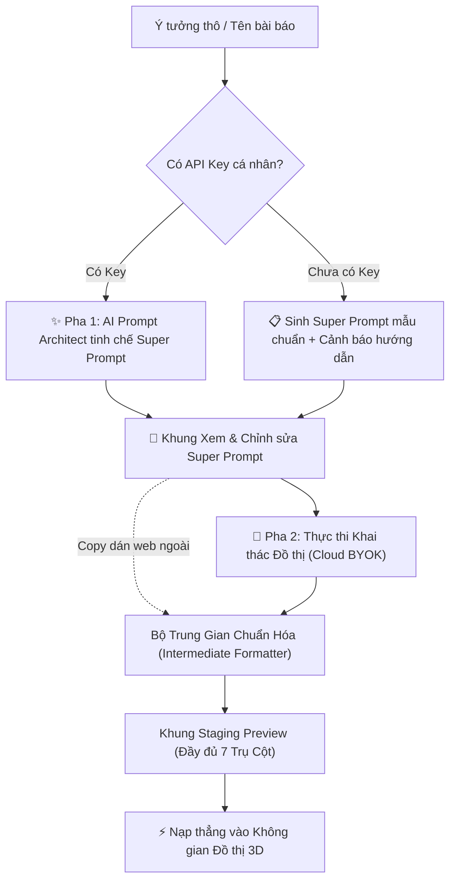

# ◈ Filio3D — Không gian Phả hệ Nghiên cứu Khoa học 3D & Meta-Prompting Biện chứng AI

[](https://filio3d.lawnguyenit.workers.dev)
[](#-1-kiến-trúc-7-trụ-cột-tri-thức-khoa-học-the-7-pillar-taxonomy)
[](#-3-quy-trình-meta-prompting-2-pha-two-stage-meta-prompting-pipeline)

> **Filio3D** là hệ thống Đồ thị Không gian 3D Đa tầng phục vụ Nghiên cứu Khoa học chuyên sâu: tổ chức tài liệu học thuật theo **Phả hệ Biện chứng (Dialectic Lineage)**, biểu diễn trực quan các **Đòn Tấn công / Bác bỏ Điều kiện (Refutation & Attack)**, tự động đánh giá **Khắc phục Lỗ hổng trong Phả hệ (Gap Resolution)**, truy xuất **Nguồn gốc Tri thức (Knowledge Provenance)**, và ứng dụng **Quy trình Meta-Prompting 2 Pha** kết hợp **Bộ Trung Gian Chuẩn Hóa**.

🔗 **Trải nghiệm trực tiếp:** [https://filio3d.lawnguyenit.workers.dev](https://filio3d.lawnguyenit.workers.dev)

---

## 📑 Mục lục
1. [Kiến trúc 7 Trụ Cột Tri Thức Khoa Học](#-1-kiến-trúc-7-trụ-cột-tri-thức-khoa-học-the-7-pillar-taxonomy)
2. [Định danh Nguồn gốc Tri thức (Provenance Tracking)](#-2-định-danh-nguồn-gốc-tri-thức-knowledge-provenance)
3. [Quy trình Meta-Prompting 2 Pha](#-3-quy-trình-meta-prompting-2-pha-two-stage-meta-prompting-pipeline)
4. [Bản đồ Chức năng Toàn diện (Feature Map)](#-4-bản-đồ-chức-năng-toàn-diện-system-feature-map)
5. [Bản đồ Ngữ nghĩa Mũi tên Biện chứng (Dialectic Edge Semantics)](#-5-bản-đồ-ngữ-nghĩa-mũi-tên-biện-chứng-dialectic-edge-semantics)
6. [Bản đồ Kiến trúc Mã nguồn & Module](#-6-bản-đồ-kiến-trúc-mã-nguồn--module)
7. [Hướng dẫn Cài đặt & Triển khai](#-7-hướng-dẫn-cài-đặt--triển-khai-cloudflare-workers)

---

## 🏛 1. Kiến trúc 7 Trụ Cột Tri Thức Khoa Học (The 7-Pillar Taxonomy)

Khắc phục triệt để hiện tượng **Rơi rớt Điều kiện Biên (Scope-Stripping)** khi đọc tóm tắt phẳng, Filio3D chuẩn hóa mọi bài báo khoa học trên đồ thị 3D thành **7 Trụ Cột Tri Thức Học Thuật**:

| Trụ cột | Tên Trụ Cột | Ý nghĩa Học thuật & Dữ liệu Bóc Tách |
| :--- | :--- | :--- |
| **Trụ cột 1** | **💡 Đóng góp & Tuyên bố cốt lõi** (`coreKnowledge`) | Phát hiện mới, mô hình kiến trúc hoặc mệnh đề tri thức quan trọng nhất mà tác giả công bố. |
| **Trụ cột 2** | **🔬 Quá trình Xây dựng Giải pháp** (`methodPipeline`) | Quy trình phương pháp luận từng bước từ bài toán, giả định đến thuật toán và giải pháp thực thi. |
| **Trụ cột 3** | **⚖️ Điều kiện Bắt buộc Tồn tại** (`conditions`) | Giả định tiên quyết về miền dữ liệu, môi trường, đặc trưng phân phối bắt buộc phải thỏa mãn để bài báo đúng. |
| **Trụ cột 4** | **📦 Nguyên liệu, Tài nguyên & Quy mô** (`materials`) | Dataset, benchmark thực nghiệm, quy mô tham số mô hình, môi trường phần cứng kiểm thử. |
| **Trụ cột 5** | **📊 Bằng chứng Thực nghiệm & Kết quả** (`evidence`) | Số liệu đo lường định lượng và định tính (F1-score, accuracy, tốc độ, kết quả ablation study). |
| **Trụ cột 6** | **⚠️ Điểm gãy Suy luận & Giới hạn Tiềm ẩn** (`limitations`) | Điều kiện cụ thể khiến giả định bị phá vỡ, mô hình thất bại hoặc bị các bài báo đối kháng lật đổ. |
| **Trụ cột 7** | **🧬 Vị trí Phả hệ & Đánh giá Lỗ hổng** (`Dialectic Lineage Context`) | Vị trí tương quan với các công trình khác và phân tích xem điểm gãy đã được bài con nào giải quyết chưa. |

> [!IMPORTANT]
> **Cơ chế Đánh giá Khắc phục Lỗ hổng (Lineage Gap Resolution):**
> Khi kiểm tra một bài báo bị tấn công (như bài gốc `Snorkel wl-1` bị bài `wl-3` chứng minh sụp đổ khi có nhiễu tương quan), hệ thống tự động rà soát toàn bộ nhánh con:
> - **Nếu đã có bài con giải quyết** (ví dụ: bài `wl-5` dùng phân tách nhân quả để vô hiệu hóa đòn tấn công của `wl-3`): Hệ thống bật thông báo bảo vệ màu xanh: *🛡️ Lỗ hổng đã được bài kế thừa trong phả hệ khắc phục!*, tránh việc ngộ nhận một bài có lỗ hổng là toàn bộ phả hệ bị vứt bỏ.
> - **Nếu chưa có bài nào giải quyết**: Hệ thống cảnh báo đỏ: *⚡ Lỗ hổng chưa ai giải quyết — Ứng viên sáng giá cho Khe hở nghiên cứu mới (`◇`)*.

---

## 🏷 2. Định danh Nguồn gốc Tri thức (Knowledge Provenance)

Hệ thống gắn nhãn xuất xứ minh bạch cho từng bài báo và nút suy luận:

- **`[🤖 Gemini 3.8 / Claude 3.7 / GPT-4o Bóc Tách]`**: Tri thức trích xuất tự động qua LLM (ghi lại model, prompt và thời điểm tra cứu).
- **`[✍ Người dùng tự nhập]`**: Ghi chú cá nhân và bài báo do chính nhà nghiên cứu đưa vào.
- **`[◇ Quét Thuật toán Đồ thị (Static Gap Engine)]`**: Nút Khe hở nghiên cứu (`◇`) do thuật toán đồ thị phát hiện tự động dựa trên phân tích xung đột giữa các cặp bài báo.
- **`[🏛 Mẫu chuẩn hệ thống]`**: Dữ liệu phả hệ chuẩn mực được nạp sẵn.

Huy hiệu Provenance hiển thị đồng bộ trên **Ngăn nổi 3D Floating Inspector**, **Thẻ bài báo ở Tab 2**, và **Khung Staging Preview ở Tab 3**.

---

## ⚡ 3. Quy trình Meta-Prompting 2 Pha (Two-Stage Meta-Prompting Pipeline)

Tọa lạc tại **Tab 3 ("AI & Bộ Trung Gian")**, hỗ trợ 2 chế độ nghiên cứu:
- **Chế độ 1**: Phân rã Hiện tượng quan sát ➔ Tìm bài báo đối chiếu & kiểm chứng giả thuyết.
- **Chế độ 2**: Đưa 1 bài báo mục tiêu ➔ Tìm các đòn Tấn công / Bác bỏ & công trình kế thừa bảo vệ.



1. **Pha 1: Tinh chế Prompt (Meta-Prompt Architect)**:
   - LLM đảm nhận vai trò *Senior Research Epistemologist*, nâng cấp các ý niệm phân rã thô thành **Super Prompt** học thuật tối ưu riêng cho từng họ mô hình:
     - **Anthropic Claude**: Tối ưu thẻ XML (`<research_decomposition>`, `<epistemic_instructions>`).
     - **Google Gemini**: Tối ưu Grounding literature search & JSON Schema.
     - **OpenAI GPT**: Tối ưu Developer role & Structured Chain-of-Thought constraints.
   - Nếu chưa nhập API Key: Hệ thống lập tức sinh Super Prompt mẫu tương ứng và hiển thị nút **Chép Prompt Sang Web Ngoài**.
2. **Pha 2: Khai thác Đồ thị (Dialectic Extraction)**:
   - Gửi Super Prompt tới API Key cá nhân của người dùng.
   - **Bộ Trung Gian Chuẩn Hóa** tiếp nhận văn bản (JSON hoặc Markdown tự do) và biên dịch thành cấu trúc 7 Trụ Cột Tri Thức kèm các mũi tên liên kết 3D.

---

## 🗺 4. Bản đồ Chức năng Toàn diện (System Feature Map)

```text
Filio3D Workspace Ecosystem
├── 🔐 CỔNG KHÓA TRUY CẬP (HMAC-SHA256 Signed Access Gate)
│   ├── Khóa màn hình 100% đối với khách vãng lai
│   ├── Xác thực chữ ký số HMAC-SHA256 không lưu mật khẩu cứng
│   ├── Kiểm tra hạn sử dụng mã (YYYY-MM-DD hoặc PERMANENT)
│   ├── Bảng điều khiển Quản trị viên (Master Admin Panel): Sinh mã mới cho Thầy cô/Đồng nghiệp
│   └── Phân quyền: role "admin" vs "member"
│
├── 🌌 VIEW 1: KHÔNG GIAN 3D ĐA TẦNG (True Volumetric 3D Explore)
│   ├── Bộ máy Canvas 3D X-Y-Z Đa tầng:
│   │   ├── Tầng Đỉnh (Y < 0): Các bài báo Tấn công / Bác bỏ (Mũi tên đỏ)
│   │   ├── Tầng Giữa (Y ≈ 0): Chuỗi bài báo Nền móng & Kế thừa (Mũi tên tím/xanh)
│   │   └── Tầng Đáy (Y > 0): Các Nút Khe Hở Nghiên Cứu (◇) và Vấn đề chung (⬢)
│   ├── Thuật toán Lực đẩy chống đè chữ (Spatial Node Relaxation 3D)
│   ├── Điều khiển Camera 3D:
│   │   ├── 5 Góc nhìn trực giao nhanh: 🧊 Khối 3D | 👁 Chính diện | ⬇ Từ đỉnh | ➡ Cắt ngang | ↻ Xoay 360°
│   │   └── Xoay Turntable tự động 360°
│   ├── Bộ lọc Nút 3D (HUD Filters):
│   │   ├── Chọn Phả hệ hiển thị (Dropdown hoặc Sidebar)
│   │   ├── 🎯 Cô lập nhánh (Isolate Focus Node): Chỉ hiện bài được chọn cùng toàn bộ bài kế thừa & bài tấn công nó
│   │   └── Bật/tắt tầng: Vấn đề (⬢), Khe hở (◇), Chuỗi suy luận
│   ├── Floating Right Inspector (Ngăn Chi tiết Nút 3D):
│   │   ├── Huy hiệu Nguồn gốc Tri thức (Provenance Badges)
│   │   ├── Trụ cột 1: Đóng góp & Tuyên bố cốt lõi
│   │   ├── Trụ cột 2: Phương pháp luận & Quá trình xây dựng
│   │   ├── Trụ cột 3: Điều kiện tồn tại bắt buộc
│   │   ├── Trụ cột 4: Nguyên liệu, Benchmark & Quy mô
│   │   ├── Trụ cột 5: Bằng chứng thực nghiệm & Kết quả
│   │   ├── Trụ cột 6: Điểm gãy suy luận & Giới hạn sụp đổ
│   │   ├── Trụ cột 7: Phân tích Phả hệ & Cảnh báo giải quyết lỗ hổng
│   │   └── Nút "✏ Sửa bài này" chuyển nhanh sang Tab Biên soạn
│   └── Popover Câu hỏi Nghiên cứu & Chuỗi Suy luận:
│       ├── Xem chuỗi bước suy luận từ vấn đề đến giả thuyết
│       ├── Thêm bước suy luận nhanh
│       └── Nút "Xóa câu hỏi sai" (giữ nguyên 100% Phả hệ bài báo và Nút Khe Hở ◇)
│
├── 📝 VIEW 2: QUẢN LÝ & BIÊN SOẠN BÀI BÁO (Paper Editor)
│   ├── Cột Trái: Danh sách Thẻ Bài Báo Rút Gọn:
│   │   ├── Viền màu phân loại: Đỏ (Bài tấn công) vs Màu Phả hệ
│   │   ├── Chip Nguồn gốc Tri thức: 🤖 AI | ✍ Tay | 🏛 Gốc
│   │   ├── Chip Năm, Tác giả, Phả hệ, Số lượng Điều kiện biên
│   │   ├── Ô Tìm kiếm bài báo tức thì
│   │   ├── Bộ lọc theo Phả hệ
│   │   └── Nút xóa nhanh từng bài báo (✕)
│   └── Cột Phải: Form Biên Soạn Chia 4 Sub-Tabs Màu Sắc:
│       ├── Sub-tab 1 (Xanh lá): Định danh & Đóng góp (Trụ cột 1, 2, 4, 5)
│       ├── Sub-tab 2 (Hổ phách/Đỏ): Điều kiện tồn tại & Điểm gãy (Trụ cột 3, 6)
│       ├── Sub-tab 3 (Tím): Mũi tên tương tác 3D (Trụ cột 7 - Kế thừa / Tấn công)
│       ├── Sub-tab 4 (Xanh dương): Chuỗi suy luận nội tại của bài báo
│       └── Nút "🗑 Xóa bài báo này" kèm xác nhận an toàn
│
├── 🤖 VIEW 3: AI & BỘ TRUNG GIAN CHUẨN HÓA (AI Hub & Step-by-Step BYOK Flow)
│   ├── Két Khóa API Cá Nhân (Multi-Key BYOK Vault):
│   │   ├── Lưu trữ không giới hạn nhiều API Key (Gemini, OpenAI, Claude) trong Két Khóa cá nhân
│   │   ├── Hỗ trợ đầy đủ Thêm / Sửa / Xóa / Kích hoạt Key đang dùng ngay trên thanh điều khiển
│   │   ├── Cơ chế Khóa Cổng (Gatekeeper Lock) bảo vệ tài nguyên khi người dùng chưa có API Key
│   │   └── Nút "⚡ Dùng Thử Mẫu Chuẩn" để trải nghiệm ngay mà không cần nhập Key
│   ├── Bộ Chọn Chế Độ Gọn Gàng (Single-line, không xuống dòng):
│   │   ├── [💡 Phân rã Hiện tượng]: Đưa chuỗi suy luận ➔ Tìm bài báo & kiểm chứng
│   │   └── [🛡️⚔️ Tấn công & Phòng thủ]: Đưa bài báo mục tiêu ➔ Tìm đòn phản biện & kế thừa
│   ├── Quy Trình 3 Bước Toàn Màn Hình (Không cuộn dọc, Vừa vặn 100vh):
│   │   ├── Bước 1: Nhập hiện tượng quan sát & chuỗi phân rã suy luận
│   │   ├── Bước 2: Tinh chế Super Prompt (Pha 1) + Modal nổi [👁 Xem / Sửa Super Prompt]
│   │   └── Bước 3: Khai thác Đồ thị (Pha 2) + Modal nổi [🔬 Xem Bóc Tách 7 Trụ Cột]
│   └── Bộ Trung Gian Chuẩn Hóa (Intermediate Formatter):
│       ├── Bóc tách cả JSON và Markdown tự do sang 7 Trụ Cột Tri Thức
│       ├── Gắn nhãn Provenance tự động
│       └── Nút "⚡ Nạp thẳng vào Không gian 3D" chuyển ngay sang Tab 3D với góc quay tối ưu
│
├── 📊 VIEW 4: MA TRẬN ĐIỀU KIỆN & KHE HỞ (Condition Matrix & Gap Discovery)
│   ├── Bảng Thẻ Phân Tầng Đối Chiếu 4 Màu Sắc:
│   │   ├── Xanh: Bài báo nền móng & Kế thừa
│   │   ├── Đỏ: Bài báo Tấn công / Bác bỏ
│   │   ├── Vàng: Điều kiện biên ràng buộc
│   │   └── Hồng: Khe hở nghiên cứu (Research Gaps ◇)
│   ├── Cơ chế Phân trang thông minh (Pagination: 5 bài / trang)
│   ├── Thanh Tìm kiếm từ khóa bài báo / điều kiện
│   ├── Lọc theo Phả hệ nghiên cứu
│   └── Nút "✦ Dùng làm Câu hỏi nghiên cứu mới" từ Khe hở
│
└── ⚙️ QUẢN LÝ DỮ LIỆU & HỆ THỐNG
    ├── Cô lập Workspace theo từng userId: filio3d-v4-workspace::<userId>
    ├── Đồng bộ ngầm lên Cloudflare KV Storage (FILIO_KV)
    ├── Nút "🗑 Xóa trắng đồ thị" (Bắt đầu đồ thị mới từ đầu)
    ├── Nút "✦ Phả hệ mới" (Tạo nhánh nghiên cứu mới)
    ├── Nút "↺ Mẫu gốc" (Khôi phục dữ liệu học thuật mẫu)
    ├── Nút " Xuất JSON" (Tải file sao lưu mang tên người dùng)
    └── Nút " Nhập JSON" (Nạp file dữ liệu sao lưu)
```

---

## 🧭 5. Bản đồ Ngữ nghĩa Mũi tên Biện chứng (Dialectic Edge Semantics)

Mọi liên kết trong không gian Filio3D tuân thủ quy tắc biện chứng học thuật:

| Loại Mũi tên | Mã loại | Màu sắc 3D | Hướng tác động | Ngữ nghĩa Khoa học |
| :--- | :--- | :--- | :--- | :--- |
| **Kế thừa (Lineage)** | `lineage` | 🟣 Tím thẫm | Từ bài trước ➔ bài sau | Công trình đi sau kế thừa nền tảng, phát triển mở rộng phương pháp. |
| **Bác bỏ (Refutation)** | `refute` | 🔴 Đỏ tươi | Từ bài tấn công ➔ bài gốc | Chỉ ra điều kiện cụ thể làm sụp đổ giả định tiên quyết của bài gốc. |
| **Củng cố (Support)** | `support` | 🟢 Xanh lục | Từ bài cứu ➔ bài bị tấn công | Bổ sung cơ chế mới để giải quyết điểm gãy, phục hồi hiệu lực phả hệ. |
| **Tương khắc (Conflict)** | `conflict` | 🟠 Cam đậm | Giữa 2 bài mâu thuẫn | Hai bài báo đưa ra kết luận trái ngược nhau do lệch miền điều kiện biên. |

---

## 📂 6. Bản đồ Kiến trúc Mã nguồn & Module

Mã nguồn được phân tách module hóa chuẩn ES Modules:

```text
Filio3D/
├── index.html                   # Khung ứng dụng 100vh: Cổng Access Gate + 4 View chính
├── styles.css                   # Biến màu 7 Trụ Cột, Card Tokens, 3D HUD & Responsive Styles
├── wrangler.toml                # Cấu hình Cloudflare Worker + Static Assets + KV Binding
├── server.js                    # Local test server (Node.js)
├── docs/
│   └── ARCHITECTURE.md          # Bản đồ kiến trúc chi tiết từng hàm & cấu trúc dữ liệu
├── src/
│   ├── main.js                  # Entrypoint: switchView, điều phối auth & khởi tạo engine
│   ├── config/constants.js      # Danh mục điều kiện, cấu hình ARROW_TYPES, Cloud LLM Providers
│   ├── utils/dom.js             # Tiện ích DOM ($), shortAuthor, escapeHTML, Toast Notify
│   ├── data/defaultState.js     # Dữ liệu 3 Phả hệ mẫu chuẩn hóa đầy đủ 7 Trụ Cột
│   ├── auth/accessGate.js       # Xác thực HMAC-SHA256, kiểm tra hạn dùng mã, tạo key cho admin
│   ├── store/workspaceStore.js  # Multi-user isolation (LocalStorage + Cloudflare KV API)
│   ├── engine/spatial3DEngine.js# Không gian 3D Đa tầng, lực đẩy chống đè chữ, chiếu phối cảnh 360°
│   ├── engine/gapEngine.js      # Thuật toán quét cạnh refute/conflict phát hiện Khe hở (◇)
│   └── views/
│       ├── inspectorView.js     # Floating Right Inspector (7 Trụ Cột, Provenance, Lineage Resolution)
│       ├── editorView.js        # Tab 2: Thẻ bài báo gọn, chip Provenance, 4 Sub-tabs biên soạn
│       ├── aiHubView.js         # Tab 3: Two-Stage Meta-Prompting Pipeline (Pha 1 & 2) + Formatter
│       └── matrixView.js        # Tab 4: Ma trận điều kiện phân tầng, phân trang, lọc & tìm kiếm
└── functions/api/               # Cloudflare Serverless Functions
    ├── auth.js                  # POST /api/auth (Xác thực chữ ký số HMAC)
    ├── workspace.js             # GET/POST /api/workspace (Đồng bộ đồ thị theo userId qua FILIO_KV)
    └── ai-proxy.js              # POST /api/ai-proxy (Proxy gọi Claude API an toàn)
```

---

## 🚀 7. Hướng dẫn Cài đặt & Triển khai (Cloudflare Workers)

### Triển khai lên Cloudflare Workers (Miễn phí)

Dự án sử dụng kiến trúc **Cloudflare Worker với Static Assets** kết hợp **Cloudflare KV**:

```bash
# 1. Cài đặt dependencies
npm install

# 2. Đăng nhập Cloudflare CLI (nếu chưa đăng nhập)
npx wrangler login

# 3. Triển khai trực tiếp lên Cloudflare Workers
npx wrangler deploy
```

File cấu hình [`wrangler.toml`](wrangler.toml):
```toml
name = "filio3d"
main = "worker.js"
compatibility_date = "2024-09-23"

[assets]
directory = "."
binding = "ASSETS"

[[kv_namespaces]]
binding = "FILIO_KV"
id = "461bd8bda1db454fb1e10a687a9e871b"
```

### Chạy thử nghiệm Cục bộ (Local Development)

```bash
# Chạy local server bằng Node.js
npm start
# Hoặc mở http://localhost:8080 trên trình duyệt
```

---

## 🔒 8. Mật khẩu Quản trị Mặc định

- **Master Admin Secret**: `FILIO3D-ADMIN-2026`
- Dùng để mở khóa màn hình lần đầu hoặc truy cập vào **Bảng điều khiển Quản trị viên** tại cổng đăng nhập để tạo mã có thời hạn cho học viên, đồng nghiệp hoặc người đánh giá.
