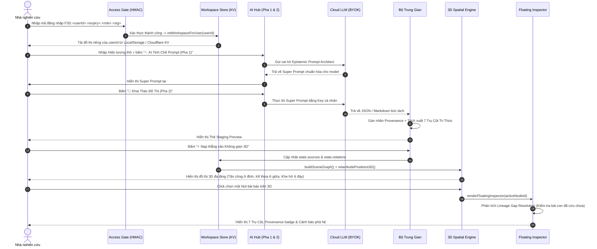

# 📐 Tài liệu Kiến trúc & Bản đồ Kỹ thuật `Filio3D`

Tài liệu này cung cấp bản đồ kỹ thuật chi tiết nhất về cấu trúc mã nguồn, các lược đồ dữ liệu (Data Schemas), vòng đời dữ liệu (Data Lifecycle), và phân hệ chức năng trong hệ thống **Filio3D**.

---

## 1. Sơ đồ Cây Thư Mục Toàn Dự Án

```text
Filio3D/
├── index.html                  # Giao diện khung 100vh: Cổng Access Gate + 4 View chính
├── styles.css                  # Toàn bộ hệ thống CSS Tokens: Màu 7 Trụ Cột, Card Styles, 3D HUD
├── wrangler.toml               # Cấu hình Cloudflare Worker + Static Assets + KV Namespace (FILIO_KV)
├── worker.js                   # Entrypoint Worker điều phối Static Assets & API Routing
├── server.js                   # Node.js local dev server
├── docs/
│   └── ARCHITECTURE.md         # [Tài liệu này] Bản đồ kỹ thuật chi tiết
├── src/                        # 🎯 MÃ NGUỒN FRONTEND MODULAR ES6
│   ├── main.js                 # Điểm khởi chạy trung tâm, điều phối switchView & auth
│   ├── config/
│   │   └── constants.js        # Hằng số ARROW_TYPES, CONDITION_CATEGORIES, CLOUD_LLM_PROVIDERS
│   ├── utils/
│   │   └── dom.js              # Tiện ích DOM ($, $$), thông báo Toast, shortAuthor, escapeHTML
│   ├── data/
│   │   └── defaultState.js     # Bộ dữ liệu 3 Phả hệ mẫu chuẩn hóa 7 Trụ Cột Tri Thức
│   ├── auth/
│   │   └── accessGate.js       # Cổng Khóa Truy Cập & Trình tạo Mã HMAC-SHA256 có thời hạn
│   ├── store/
│   │   └── workspaceStore.js   # Multi-user isolation (filio3d-v4-workspace::<userId> + Cloud KV)
│   ├── engine/
│   │   ├── gapEngine.js        # Thuật toán quét cạnh refute/conflict phát hiện Khe hở nghiên cứu (◇)
│   │   └── spatial3DEngine.js  # Không gian 3D Đa tầng (X-Y-Z), lực đẩy chống đè chữ & Camera 360°
│   └── views/
│       ├── inspectorView.js    # Ngăn chi tiết 3D Floating Inspector (7 Trụ Cột, Provenance, Lineage Resolution)
│       ├── editorView.js       # Tab 2: Quản lý thẻ bài báo rút gọn, chip Provenance & 4 Sub-tabs biên soạn
│       ├── aiHubView.js        # Tab 3: Two-Stage Meta-Prompting (Pha 1 & 2) + Bộ Trung Gian Chuẩn Hóa
│       └── matrixView.js       # Tab 4: Ma trận điều kiện phân tầng, phân trang, lọc & tìm kiếm
└── functions/api/               # ☁️ CLOUDFLARE SERVERLESS FUNCTIONS
    ├── auth.js                 # Xác thực chữ ký số HMAC-SHA256 & kiểm tra hạn sử dụng
    ├── workspace.js            # Đồng bộ đồ thị theo từng userId trên Cloudflare KV
    └── ai-proxy.js             # Proxy gọi Claude API bằng API Key cá nhân
```

---

## 2. Lược đồ Dữ liệu Chuẩn (Data Schemas)

### A. Lược đồ Bài Báo Khoa học 7 Trụ Cột (`PaperNode`)
Mỗi bài báo trong mảng `state.sources` được chuẩn hóa theo cấu trúc sau:

```typescript
interface PaperNode {
  // Định danh & Siêu dữ liệu cơ bản
  id: string;                      // ID duy nhất, ví dụ: 'wl-1', 'p-ai-abc-1'
  title: string;                   // Tiêu đề bài báo khoa học chính xác
  authors: string;                 // Danh sách tác giả (ví dụ: 'A. Ratner et al.')
  year: number;                    // Năm xuất bản (ví dụ: 2017)
  venue: string;                   // Hội nghị / Tạp chí uy tín (NeurIPS, ICML, ICLR, ACL, Nature)
  url?: string;                    // Đường dẫn tới bài báo gốc (arXiv, DOI)
  ecosystemId: string;             // ID Phả hệ trực thuộc (ví dụ: 'eco-weak-label')
  problemId?: string;              // ID Vấn đề chung đang giải quyết (ví dụ: 'prob-weak-noise')

  // Định danh Xuất xứ & Nguồn gốc Tri thức (Knowledge Provenance)
  provenance: {
    type: 'ai' | 'manual' | 'algo' | 'system';
    origin?: string;               // Mô tả xuất xứ ngắn
    model?: string;                // Model thực thi (ví dụ: 'gemini-3.8-flash', 'claude-3-7-sonnet')
    provider?: string;             // Nhà cung cấp API ('gemini-api', 'openai-api', 'claude-api')
    mode?: string;                 // Mode bóc tách ('decompose' | 'attack_defense')
    timestamp: number;             // Thời điểm tạo (Unix timestamp)
  };

  // 7 TRỤ CỘT TRI THỨC KHOA HỌC (THE 7-PILLAR TAXONOMY)
  coreKnowledge: string;           // Trụ cột 1: Đóng góp & Tuyên bố cốt lõi
  methodPipeline: string;          // Trụ cột 2: Quy trình xây dựng giải pháp / Phương pháp luận
  conditions: Array<{              // Trụ cột 3: Điều kiện bắt buộc tồn tại để bài báo đúng
    category: 'method' | 'data' | 'environment' | 'metric';
    factor: string;                // Tên yếu tố (ví dụ: 'Giả định độc lập', 'Tỷ lệ mất cân bằng')
    value: string;                 // Giá trị ràng buộc cụ thể
  }>;
  materials: string;               // Trụ cột 4: Nguyên liệu, Benchmark, Quy mô tham số & Phần cứng
  evidence: string;                // Trụ cột 5: Bằng chứng thực nghiệm & Kết quả đo lường (F1, Accuracy)
  limitations: string;             // Trụ cột 6: Điểm gãy suy luận & Giới hạn sụp đổ khi bị tấn công

  // Trụ cột 7 (Vị trí Phả hệ) được tính toán động qua mảng state.relations

  // Chuỗi suy luận nội tại (Internal Chain)
  internalChain?: Array<{
    stage: string;                 // 'Vấn đề' | 'Điều kiện' | 'Phương pháp' | 'Kết luận'
    text: string;
  }>;
}
```

### B. Lược đồ Mũi tên Biện chứng 3D (`RelationEdge`)
Mỗi liên kết trong mảng `state.relations`:

```typescript
interface RelationEdge {
  id: string;                      // ID duy nhất: 'rel-wl-1'
  from: string;                    // ID bài báo nguồn
  to: string;                      // ID bài báo đích
  type: 'lineage' | 'refute' | 'support' | 'conflict';
  label: string;                   // Mô tả quan hệ học thuật
  conditionNote?: string;          // Ghi chú về điều kiện biên gây ra mối quan hệ này
}
```

### C. Lược đồ Khe hở Nghiên cứu (`ResearchGapNode`)
Do thuật toán `src/engine/gapEngine.js` quét và tạo ra:

```typescript
interface ResearchGapNode {
  id: string;                      // 'gap-refute-p1-p2'
  kind: string;                    // 'KHE HỞ ĐIỀU KIỆN BIÊN KHI BỊ BÁC BỎ'
  title: string;                   // Tiêu đề khe hở
  summary: string;                 // Lý do tại sao tồn tại lỗ hổng này giữa 2 bài báo
  missingCondition: string;        // Điều kiện chưa ai giải quyết được
  suggestedQuestion: string;       // Câu hỏi nghiên cứu đề xuất giải quyết khe hở
  paperAId: string;
  paperBId: string;
  ecosystemId: string;
}
```

---

## 3. Vòng đời Dữ liệu Toàn diện (End-to-End Data Lifecycle)



---

## 4. Chi tiết Chức năng Từng Module Mã nguồn

### 1. `src/auth/accessGate.js` & `functions/api/auth.js`
- **Nhiệm vụ**: Bảo vệ hệ thống khỏi truy cập trái phép; phân quyền người dùng.
- **Cơ chế**:
  - Không lưu mật khẩu người dùng trên máy chủ.
  - Sử dụng chữ ký số `HMAC-SHA256` với khóa bí mật (`MASTER_ADMIN_SECRET`).
  - Định dạng mã: `F3D.<userId>.<YYYY-MM-DD|PERMANENT>.<admin|member>.<sig>`.
  - Có chế độ Admin Panel để tạo mã mới có hạn dùng gửi cho Thầy cô hoặc đồng nghiệp.

### 2. `src/store/workspaceStore.js` & `functions/api/workspace.js`
- **Nhiệm vụ**: Đảm bảo phân vùng lưu trữ cô lập tuyệt đối theo từng `userId`.
- **Hàm cốt lõi**:
  - `initWorkspaceForUser(session)`: Khởi tạo dữ liệu người dùng.
  - `getState()` / `setState()`: Quản lý biến trạng thái đồ thị tập trung.
  - `saveState()`: Ghi vào `localStorage` và đẩy bất đồng bộ lên Cloudflare KV (`FILIO_KV`).
  - `deletePaper(id)`: Xóa một bài báo và tự động gỡ bỏ toàn bộ mũi tên 3D liên quan.
  - `clearWorkspaceState()`: Xóa sạch đồ thị để người dùng tạo dự án mới từ trang trắng.
  - `getUserPersonalApiKey(provider)` / `saveUserPersonalApiKey(provider, key)`: Lưu trữ API Key cá nhân an toàn.

### 3. `src/engine/spatial3DEngine.js`
- **Nhiệm vụ**: Bộ máy dựng hình không gian 3 chiều thuần Canvas 2D không phụ thuộc thư viện nặng.
- **Cơ chế**:
  - **Phân tầng độ cao $Y$**:
    - $Y < 0$: Tầng trên dành cho Bài báo Tấn công / Bác bỏ (`refute`).
    - $Y \approx 0$: Tầng giữa dành cho Dòng chảy kế thừa (`lineage`).
    - $Y > 0$: Tầng đáy dành cho Khe hở nghiên cứu (`◇`) và Vấn đề chung (`⬢`).
  - **Thuật toán lực đẩy 3D (`relaxNodePositions3D`)**: Đẩy các nút ra xa nhau theo khoảng cách tối thiểu, chống đè chữ và chèn ép nhãn bài báo.
  - **Phép chiếu 3D (`project3D`)**: Chiếu từ không gian $(X, Y, Z)$ lên $(u, v)$ màn hình với góc quay `yaw`, `pitch` mượt mà.
  - **5 Góc nhìn nhanh trực giao**: `🧊 Khối 3D`, `👁 Chính diện`, `⬇ Từ đỉnh`, `➡ Cắt ngang`, `↻ Xoay 360°`.

### 4. `src/engine/gapEngine.js`
- **Nhiệm vụ**: Tự động phát hiện Khe hở nghiên cứu (`◇`) giữa các công trình mâu thuẫn.
- **Hàm cốt lõi**:
  - `computeEcosystemGaps(filterEcoId, isolatedPaperIds)`: Tìm các cặp bài có cạnh `refute` hoặc `conflict` mà chưa có bài thứ ba dung hòa điều kiện biên.
  - `promoteGapToQuestion(gap, onPromoted)`: Chuyển hóa Khe hở thành Câu hỏi nghiên cứu mới trên đồ thị.

### 5. `src/views/inspectorView.js`
- **Nhiệm vụ**: Hiển thị bảng chi tiết Floating Right Inspector khi click chọn nút trên đồ thị 3D.
- **Đặc điểm nổi bật**:
  - Hiển thị đầy đủ **7 Trụ Cột Tri Thức Khoa Học**.
  - Hiển thị **Huy hiệu Nguồn gốc Tri thức (Provenance Badges)**: `[🤖 AI]`, `[✍ Người dùng]`, `[◇ Quét thuật toán]`.
  - Phân tích **Lineage Gap Resolution**: Kiểm tra xem điểm gãy của bài báo đã được bài con nào trong cùng phả hệ khắc phục chưa.
  - Nút **"🎯 Chỉ hiện Phả hệ & Bài tấn công bài này"** (Cô lập nhánh nghiên cứu).
  - Nút **"✏ Sửa bài này"** chuyển hướng tức thì sang Tab Biên Soạn.

### 6. `src/views/editorView.js`
- **Nhiệm vụ**: Giao diện Quản lý và Chỉnh sửa Bài báo (Tab 2).
- **Đặc điểm nổi bật**:
  - Cột trái: Thẻ bài báo rút gọn có chip Provenance, chip Phả hệ, viền màu trạng thái, bộ lọc Phả hệ và ô tìm kiếm tức thì.
  - Cột phải: Form biên soạn 4 Sub-tabs phân màu (Định danh & Đóng góp, Điều kiện & Điểm gãy, Mũi tên 3D, Chuỗi suy luận).
  - Nút **"🗑 Xóa bài báo này"** giúp xóa bỏ an toàn từng bài báo thừa.

### 7. `src/views/aiHubView.js`
- **Nhiệm vụ**: Quản lý Tab 3 — Two-Stage Meta-Prompting Pipeline & Bộ Trung Gian Chuẩn Hóa.
- **Hàm cốt lõi**:
  - `buildEpistemicMetaPrompt()`: Xây dựng prompt cho AI Prompt Architect (Pha 1).
  - `buildAiResearchPrompt()`: Xây dựng Super Prompt mẫu chuẩn hóa cho từng họ mô hình (Claude / Gemini / GPT).
  - `callCloudLlmWithUserKey()`: Gọi trực tiếp Gemini / OpenAI từ trình duyệt hoặc qua Cloudflare Worker proxy cho Claude API bằng Key cá nhân (BYOK).
  - `parseRawAiOutputToGraph()`: Bộ Trung Gian bóc tách văn bản thô / JSON sang 7 Trụ Cột Tri Thức.
  - `renderStagingPreview()`: Hiển thị bản xem trước thẻ bài báo kèm 7 Trụ Cột trước khi nạp vào đồ thị.

### 8. `src/views/matrixView.js`
- **Nhiệm vụ**: Tab 4 — Ma trận Điều kiện & Khe hở Nghiên cứu.
- **Đặc điểm nổi bật**:
  - Hiển thị các khối thẻ đối chiếu 4 màu (Nền tảng, Tấn công, Điều kiện biên, Khe hở ◇).
  - Cơ chế **Phân trang thông minh** (Pagination: 5 bài / trang) tránh tràn màn hình khi có nhiều bài báo.
  - Ô tìm kiếm từ khóa và bộ lọc theo Phả hệ.

---

## 5. Hướng dẫn Bảo trì & Mở rộng (Developer Guide)

### Thêm một Trụ cột hoặc Trường dữ liệu mới vào Bài báo:
1. Cập nhật schema trong `src/data/defaultState.js` và hàm `createDefaultState()`.
2. Bổ sung trường hiển thị trong `renderFloatingInspector()` tại `src/views/inspectorView.js`.
3. Bổ sung trường nhập liệu trong `index.html` (Tab 2) và ánh xạ qua `populatePaperEditorForm` / save handler tại `src/views/editorView.js`.
4. Bổ sung vào định dạng JSON của `buildAiResearchPrompt()` và bộ bóc tách `parseRawAiOutputToGraph()` tại `src/views/aiHubView.js`.
5. Bổ sung style màu sắc tương ứng trong `styles.css`.

### Triển khai Phiên bản Mới lên Cloudflare:
```bash
# 1. Kiểm tra cú pháp toàn bộ file JS
node -c src/main.js
node -c src/views/inspectorView.js
node -c src/views/aiHubView.js
node -c src/views/editorView.js

# 2. Commit git
git add .
git commit -m "feat: your feature"
git push origin main

# 3. Deploy Cloudflare Workers
npx wrangler deploy
```
